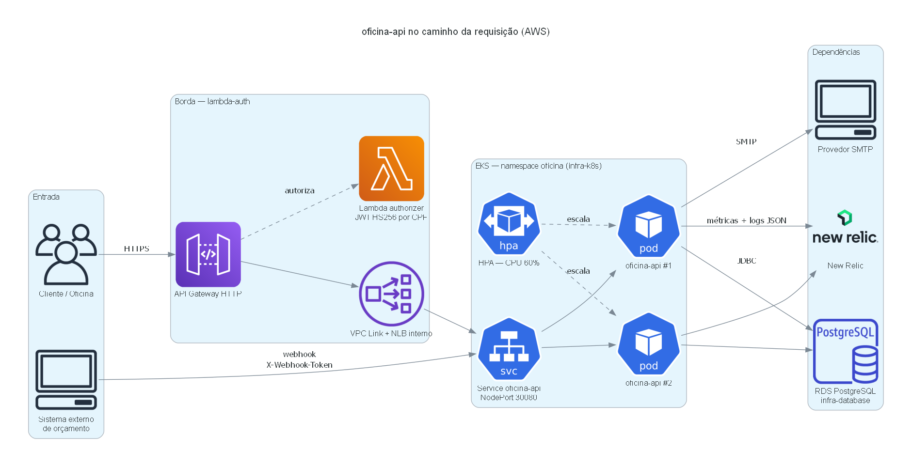

# oficina-api

Quarto dos quatro repositórios da Fase 3 do Tech Challenge FIAP PosTech
(SOAT). Sistema Integrado de Atendimento e Execução de Serviços para
oficina mecânica: cadastro de clientes/veículos/serviços/peças, abertura e
acompanhamento de Ordens de Serviço e notificação por e-mail — em **Clean Architecture**, publicado como imagem
Docker e implantado no cluster **EKS** provisionado por `infra-k8s`.

## Propósito

Este repositório contém a aplicação de negócio propriamente dita: a API
REST que o cliente final acessa (via o API Gateway de `lambda-auth`) para
consultar o andamento da sua OS, e que a oficina usa para conduzir todo o
fluxo de atendimento — do cadastro do cliente à entrega do veículo. É o
único dos quatro repositórios que não é só infraestrutura. Sua pipeline
roda o Terraform da fila da saga e da role do pod, publica a imagem no ECR e
aplica os manifestos de `k8s/` no cluster.

## Tecnologias

| Camada | Tecnologia |
|---|---|
| Linguagem | Java 21 |
| Framework | Spring Boot 3.4.5 |
| Arquitetura | Clean Architecture (Entities / Use Cases / Gateways / Presenters / Controllers) |
| Banco de dados | PostgreSQL 16 (RDS gerenciado por `infra-database`) |
| Migrations | Flyway |
| Segurança | Spring Security + JWT (JJWT 0.12) — JWT emitido por `lambda-auth` para o cliente final; login administrativo próprio para a equipe da oficina |
| Notificações | Spring Mail (SMTP/SendGrid) |
| Documentação | SpringDoc OpenAPI / Swagger UI |
| Observabilidade | Agente Java New Relic + Micrometer (métricas de negócio) + logs JSON com correlação |
| Testes | JUnit 5 + Mockito + Testcontainers + ArchUnit |
| Cobertura | JaCoCo (mínimo 80% de linhas no bundle) |
| Container | Docker (multi-stage, usuário não-root, healthcheck) |
| Orquestração | Kubernetes (EKS, via `infra-k8s`) + HPA |
| CI/CD | GitHub Actions (build, testes, imagem no ECR, rollout no EKS) |

## Arquitetura

### Clean Architecture (por Bounded Context)

```
br.com.oficina.<contexto>/
├── entities/        # Entidade de domínio + Value Objects — regra de negócio pura
├── usecases/        # Um Use Case por operação; fala com Gateways via interface
├── gateways/        # Ports (interfaces) — sem framework
├── presenters/      # Monta o Response/ViewModel a partir da saída do Use Case
├── controllers/     # Recebe DTO, chama Use Case, devolve via Presenter
└── infrastructure/  # Frameworks & Drivers: JPA (*Data), *GatewayImpl, config, mappers
```

A regra de dependência (sempre para dentro) é validada por um teste
**ArchUnit** (`br.com.oficina.architecture.ArchitectureTest`). Decisão
registrada em [`docs/adr/0001-clean-architecture.md`](https://github.com/olavowilke/soat-oficina-api/blob/main/docs/adr/0001-clean-architecture.md).

### Esta aplicação no caminho da requisição (AWS)



O desenho é gerado por código, com ícones oficiais da AWS: [`docs/arquitetura/diagramas/caminho-requisicao-aws.py`](https://github.com/olavowilke/soat-oficina-api/blob/main/docs/arquitetura/diagramas/caminho-requisicao-aws.py). Para regerar, instale `graphviz` e rode `pip install diagrams && python docs/arquitetura/diagramas/caminho-requisicao-aws.py`.

Este repositório é dono da **imagem** (`Dockerfile`), do **código** e dos
**manifestos Kubernetes** (`k8s/`: `Namespace`, `ServiceAccount`, `ConfigMap`,
`Deployment`, `Service`, `HPA`, `PDB`; overlay `k8s/overlays/homolog`). A rede e
o cluster pertencem a `infra-k8s`. Ver [`docs/arquitetura/componentes.md`](https://github.com/olavowilke/soat-oficina-api/blob/main/docs/arquitetura/componentes.md)
para a visão completa dos 4 repositórios juntos.

## Passos de execução (local)

### Pré-requisitos

- Java 21+, Maven 3.9+ (ou o wrapper incluso, `./mvnw`)
- Docker e Docker Compose

### Rodando

```bash
docker compose up -d db localstack   # banco e SQS local (as filas e DLQs nascem sozinhas)
SPRING_CLOUD_AWS_SQS_ENDPOINT=http://localhost:4566 \
AWS_ACCESS_KEY_ID=test AWS_SECRET_ACCESS_KEY=test \
./mvnw -s settings.xml spring-boot:run
# ou, tudo via compose (já define o endpoint e as credenciais falsas):
docker compose up --build
```

O LocalStack cria `oficina-homolog-os-saga-replies`, `oficina-homolog-billing-commands` e
`oficina-homolog-execution-commands`, cada uma com DLQ (`-dlq`, redrive após 3 recebimentos).
O script fica em [`docker/localstack/init-sqs.sh`](docker/localstack/init-sqs.sh).
Billing e Execution não rodam neste compose: para ver a saga andar, envie as respostas
com `aws --endpoint-url http://localhost:4566 sqs send-message`.
Sem `SPRING_CLOUD_AWS_SQS_ENDPOINT`, o cliente usa a AWS real e as credenciais do Pod Identity.

A API estará disponível em `http://localhost:8080/api`. Variáveis de
ambiente completas (banco, JWT, e-mail) e o passo a passo de
autenticação/admin padrão estão documentados inline em
[`src/main/resources/application.yml`](src/main/resources/application.yml).

### Testes

```bash
./mvnw -s settings.xml verify   # testes + JaCoCo (Testcontainers sobe o Postgres sozinho)
```

## Deploy

A aplicação é implantada no cluster provisionado por `infra-k8s`. O `cd.yml`
faz o deploy inteiro:

```bash
# build + push (feito pela pipeline, via ECR — ver secrets abaixo)
docker build -t <ecr_repository_url>:sha-<git-sha> .
docker push <ecr_repository_url>:sha-<git-sha>

# Namespace e Secret oficina-secrets primeiro; depois a imagem e um unico apply
aws eks update-kubeconfig --name <cluster_name> --region <aws_region>
cd k8s/overlays/homolog
kustomize edit set image "oficina-api=<ecr_repository_url>:sha-<git-sha>"
kustomize build . | kubectl apply -f -
kubectl -n oficina rollout status deploy/oficina-api --timeout=300s
```

O workflow `cd.yml` (push em `main` → ambiente `homolog`) roda esses passos.
Antes, o job `terraform` cria a fila de respostas da saga e a role do pod.
Depois do apply, o workflow lê a URL do ECR, o cluster e o endpoint do API
Gateway no SSM (publicados por `infra-k8s` e `lambda-auth`). Ele cria o Secret
`oficina-secrets` e roda um smoke test em `/api/actuator/health`.

> **Nota de organização do monorepo:** enquanto os 4 repositórios convivem
> como diretórios deste monorepo (antes do split — ver
> [`scripts/split-repos.sh`](https://github.com/olavowilke/tech-challenge-1/blob/main/scripts/split-repos.sh)),
> esta pipeline roda a partir de `.github/workflows/` na **raiz** do
> monorepo (`working-directory`/`context` apontando para `oficina-api/`).
> `oficina-api/.github/workflows/` já existe dentro deste diretório, com o
> mesmo par `ci.yml`/`cd.yml` reescrito com caminhos relativos à raiz DESTE
> repositório — mas fica inerte enquanto o diretório vive dentro do
> monorepo (nenhum evento do GitHub Actions do monorepo aciona esses
> arquivos). Ele só passa a rodar de fato depois do split, quando
> `oficina-api/` vira a raiz do próprio repositório publicado.

## Documentação da API (Swagger / Postman)

Com a aplicação rodando:

- **Swagger UI:** `http://localhost:8080/api/swagger-ui.html`
- **OpenAPI JSON:** `http://localhost:8080/api/v3/api-docs`
- **Via API Gateway (produção/homolog):** `https://<api_endpoint>/api/swagger-ui.html`

A especificação OpenAPI é a fonte da coleção e pode ser importada direto no
Postman/Insomnia (*Import → Link*) a partir do OpenAPI JSON acima.

## Secrets e variables da pipeline

O `cd.yml` precisa dos secrets e variables abaixo. O `ci.yml` não precisa de nenhum.

| Nome | Tipo | O que quebra se estiver ausente |
|---|---|---|
| `AWS_DEPLOY_ROLE_ARN` | Secret | O passo "Credenciais AWS (OIDC)" falha. Nenhum job de deploy roda |
| `TF_STATE_BUCKET` | Secret | `terraform init` falha (backend S3 sem bucket) |
| `TF_LOCK_TABLE` | Secret | `terraform init` falha (backend sem tabela de lock) |
| `ADMIN_USERNAME` | Secret | O passo do Secret `oficina-secrets` falha. Sem ele a aplicação usaria o padrão público |
| `ADMIN_PASSWORD` | Secret | Mesmo efeito de `ADMIN_USERNAME` |
| `MAIL_USERNAME` | Secret | O Secret sobe com valor vazio. O envio real de e-mail falha |
| `MAIL_PASSWORD` | Secret | Mesmo efeito de `MAIL_USERNAME` |
| `NEW_RELIC_LICENSE_KEY` | Secret | O Secret sobe com valor vazio. O agente New Relic não liga |
| `DEPLOY_HOMOLOG` | Variable | Precisa ser `true`. Com outro valor, nenhum job de deploy roda |
| `AWS_REGION` | Variable | Opcional. Sem ela, a pipeline usa `us-east-1` |

A role `AWS_DEPLOY_ROLE_ARN` precisa de três grupos de permissão. O primeiro é
o que `infra-k8s` já exige. O segundo é o do Terraform deste repositório (SQS,
IAM e Pod Identity da oficina-api). O terceiro é o de ECR (`ecr:GetAuthorizationToken`,
`ecr:BatchCheckLayerAvailability`, `ecr:PutImage`, `ecr:InitiateLayerUpload`,
`ecr:UploadLayerPart`, `ecr:CompleteLayerUpload`). Ver
[`infra-k8s/README.md`](https://github.com/olavowilke/soat-infra-k8s/blob/main/README.md#pipelines-githubworkflows).

## Operação

- **Aprovação abandonada.** Se o cliente não responde ao orçamento, a saga fica em `AGUARDANDO_APROVACAO`. A equipe recusa o orçamento no Billing por `kubectl port-forward`. O Billing manda `OrcamentoRecusado`, e a OS é cancelada.
- **Estorno falhou.** A saga fica `FALHOU` e a OS fica `AGUARDANDO_EXECUCAO`. Só um ADMIN age:
  - `POST /api/ordens-servico/{id}/saga/estorno` pede o estorno de novo (202).
  - `POST /api/ordens-servico/{id}/saga/cancelar-apos-estorno-manual` devolve as peças, cancela a OS e compensa a saga (200). Use depois de estornar fora do sistema.
  - Os dois devolvem 409 se o último estorno da OS não falhou.
- **DLQs.** Cada fila tem uma DLQ com o sufixo `-dlq` (`oficina-homolog-os-saga-replies-dlq` e as outras). Uma mensagem vai para lá depois de 3 recebimentos sem sucesso. O alerta de DLQ avisa o operador.

## Justificativa do banco de dados

PostgreSQL foi escolhido por suporte nativo a UUID, maturidade
transacional (ACID), compatibilidade com Flyway/Hibernate e ampla adoção —
justificativa completa e o diagrama entidade-relacionamento estão em
[`infra-database/docs/modelo-dados.md`](https://github.com/olavowilke/soat-infra-database/blob/main/docs/modelo-dados.md)
(repositório dono do ciclo de vida do banco).

## Documentação complementar

A documentação de arquitetura compartilhada entre os 4 repositórios da
Fase 3 (`docs/`) tem **cópia canônica neste repositório** (o script de
split copia `docs/` para a raiz deste repositório junto com o conteúdo de
`oficina-api/`) — os outros três (`lambda-auth`, `infra-k8s`,
`infra-database`) linkam para cá em vez de duplicar. Por consistência com
os outros três READMEs, os links abaixo também usam a URL absoluta deste
repositório (funcionam a partir de qualquer um dos quatro):

| Documento | Conteúdo |
|---|---|
| [`docs/arquitetura/componentes.md`](https://github.com/olavowilke/soat-oficina-api/blob/main/docs/arquitetura/componentes.md) | Diagrama de componentes dos 4 repositórios na AWS |
| [`docs/arquitetura/sequencia.md`](https://github.com/olavowilke/soat-oficina-api/blob/main/docs/arquitetura/sequencia.md) | Diagramas de sequência (autenticação por CPF, abertura de OS) |
| [`docs/arquitetura/cicd.md`](https://github.com/olavowilke/soat-oficina-api/blob/main/docs/arquitetura/cicd.md) | Pipelines, ordem de apply e secrets/variables de todos os repositórios |
| [`docs/adr/`](https://github.com/olavowilke/soat-oficina-api/tree/main/docs/adr) | Decisões de arquitetura (Clean Architecture, API Gateway síncrono, HPA, 4 repositórios, contrato via SSM) |
| [`docs/rfc/`](https://github.com/olavowilke/soat-oficina-api/tree/main/docs/rfc) | RFCs (nuvem, API Gateway, autenticação, banco de dados) |
| [`design-docs/tech-challenge-2/PLANEJAMENTO-FASE-2.md`](https://github.com/olavowilke/tech-challenge-1/blob/main/design-docs/tech-challenge-2/PLANEJAMENTO-FASE-2.md) | Planejamento da Fase 2 (permanece no monorepo original, não faz parte do split) |
| [Board Miro — Documentação DDD](https://miro.com/app/board/uXjVOXA0ID4=/) | Event Storming, Context Map, Agregados e Linguagem Ubíqua |

> **Nota de organização do monorepo:** enquanto os 4 repositórios convivem
> como diretórios deste monorepo (antes do split — ver
> [`scripts/split-repos.sh`](https://github.com/olavowilke/tech-challenge-1/blob/main/scripts/split-repos.sh)),
> `docs/` vive na raiz do monorepo, um nível acima de `oficina-api/`. O
> script de split copia `docs/adr`, `docs/rfc` e `docs/arquitetura` para a
> raiz do repositório publicado — os workflows da aplicação **não**
> precisam dessa cópia: `oficina-api/.github/workflows/` já existe dentro
> deste diretório (ver nota equivalente na seção "CI/CD" acima).
